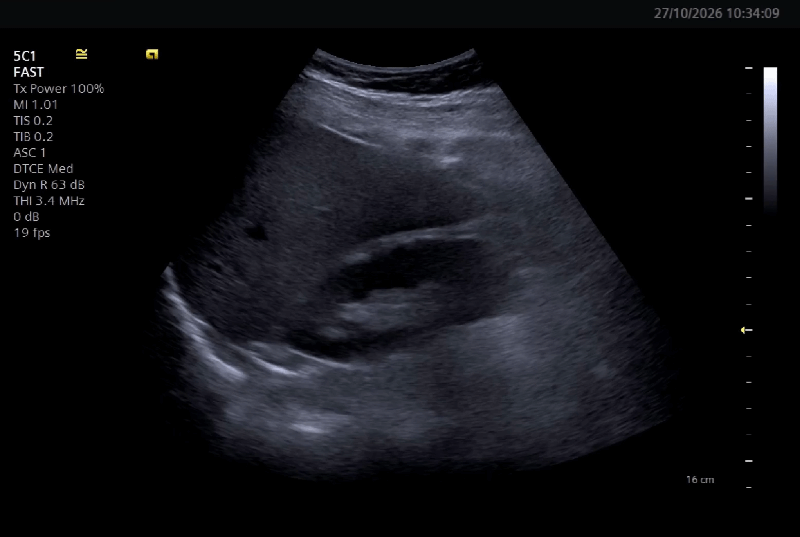

# USB Ultrasound for ROS 2

Stream a USB ultrasound probe into ROS 2 with GPU-accelerated H.264 video, a local preview, and automatic reconnection.

<p align="center">

</p>
Built for **ROS 2 Humble** and **V4L2 devices**, `ultrasound_usb` publishes compressed video through `image_transport` and `ffmpeg_image_transport`, ready for viewing or recording with rosbag.

- **Full HD capture:** 1920 × 1080 at a requested 30 FPS.
- **NVIDIA encoding:** H.264 compression with NVENC.
- **Local preview:** a 720-pixel-high window without extra DDS traffic.
- **Automatic recovery:** capture retries, a watchdog, and process restart through the launch file.

## Requirements

- A USB probe exposing a V4L2 device with YUYV 1080p/30 support.
- ROS 2 Humble and the `ffmpeg_image_transport` plugin on the publisher and receiver.
- An NVIDIA GPU with NVENC, working drivers, and an FFmpeg build with `h264_nvenc`. There is no CPU fallback; verify encoder availability on Jetson as well.

Close other applications using the probe, including FFplay, before starting.

## Quick start

Run these commands from your ROS 2 workspace, with this package under `src/ultrasound_usb`:

```bash
source /opt/ros/humble/setup.bash
sudo apt install ros-humble-ffmpeg-image-transport
rosdep install --from-paths src/ultrasound_usb --ignore-src -r -y
colcon build --packages-select ultrasound_usb
source install/setup.bash
ros2 launch ultrasound_usb ultrasound.launch.py device:=/dev/video12
```

Replace `/dev/video12` with your probe's device path. To run without the preview:

```bash
ros2 launch ultrasound_usb ultrasound.launch.py device:=/dev/video12 preview:=false
```

The node checks the negotiated resolution and logs the actual capture FPS. Press **q** or **Esc** to close the preview. It is disabled automatically when neither `DISPLAY` nor `WAYLAND_DISPLAY` is set.

## View and record

On the receiving computer, install the transport plugin and open the image viewer:

```bash
sudo apt install ros-humble-ffmpeg-image-transport ros-humble-rqt-image-view
ros2 run rqt_image_view rqt_image_view
```

Select `/ultrasound_image` with the **ffmpeg** transport and a **best-effort** subscription.

Record the compressed stream with:

```bash
ros2 bag record /ultrasound_image/ffmpeg
```

Only the FFmpeg transport is enabled: no raw images are published. Encoding starts when a subscriber connects, including rosbag. Packets use `ffmpeg_image_transport_msgs/msg/FFMPEGPacket`.

## Configuration

Edit [config/ultrasound.yaml](config/ultrasound.yaml) before building, or load a custom parameter file:

```bash
ros2 launch ultrasound_usb ultrasound.launch.py params_file:=/absolute/path/to/ultrasound.yaml
```

Use the launch file to load the encoder settings and enable automatic restart. The `device` argument overrides the YAML only when supplied; `preview` always overrides it and defaults to `true`.

The included configuration uses:

| Setting                            | Value               | Purpose                                                                     |
| ---------------------------------- | ------------------- | --------------------------------------------------------------------------- |
| `device`                           | `/dev/video12`      | V4L2 capture device                                                         |
| `image_topic`                      | `/ultrasound_image` | Base topic; compressed packets appear under `/ffmpeg`                       |
| `width`, `height`                  | `1920`, `1080`      | Capture and encoding resolution                                             |
| `fps`                              | `30.0`              | Requested capture frame rate                                                |
| `fourcc`                           | `YUYV`              | USB pixel format                                                            |
| `frame_id`                         | `probe`             | ROS header frame                                                            |
| `preview`                          | `true`              | Local preview                                                               |
| `monochrome`                       | `false`             | Convert to grayscale before encoding                                        |
| `reconnect_interval`               | `2.0`               | Seconds between capture retries                                             |
| `capture_timeout`                  | `15.0`              | Seconds without progress before watchdog termination; allowed range: 1–3600 |
| `ultrasound_image.ffmpeg.encoder`  | `h264_nvenc`        | NVIDIA H.264 encoder                                                        |
| `ultrasound_image.ffmpeg.bit_rate` | `12000000`          | Target bitrate in bit/s                                                     |
| `ultrasound_image.ffmpeg.gop_size` | `30`                | Frames between keyframes                                                    |

The encoder uses VBR, preset `p5`, quality target `cq:16`, no B-frames, and no lookahead. H.264 is lossy, and the target bitrate is not a fixed network bandwidth limit.

If you change `image_topic` or add a namespace, update the `ultrasound_image` plugin parameter prefix to match the resolved base topic, replacing slashes with dots.

ROS headers accompany each packet. Timestamps are taken after capture, rather than from the device hardware. The node does not publish `CameraInfo` or TF.


## Troubleshooting

**Check NVENC support**

Confirm that the encoder is listed, then test that it can actually encode:

```bash
ffmpeg -hide_banner -encoders | grep h264_nvenc
ffmpeg -f lavfi -i testsrc2=size=1920x1080:rate=30 -frames:v 30 \
  -c:v h264_nvenc -preset p5 -rc vbr -cq 16 -b:v 12M -g 30 -bf 0 \
  -rc-lookahead 0 -f null -
```

**Check transport QoS**

The stream uses best-effort, volatile delivery. The node requests depth 1, but the standard FFmpeg plugin raises the queue to at least `2 × GOP`, which can mean depth 60 with the included settings:

```bash
ros2 topic info /ultrasound_image/ffmpeg --verbose
```

Packet loss can affect decoding until the next keyframe: about one second at 30 FPS with GOP 30.

**Resolve OpenCV library conflicts**

Warnings about both `libopencv_*.so.411` and `libopencv_*.so.4.5d` indicate mixed OpenCV versions. Align the node's libraries and headers with those used by `cv_bridge` and `ffmpeg_image_transport`, or rebuild all affected packages against the same version. Automatic restart cannot fix this incompatibility.

See [ffmpeg_image_transport](https://github.com/ros-misc-utilities/ffmpeg_image_transport) for packet format and decoder details.
